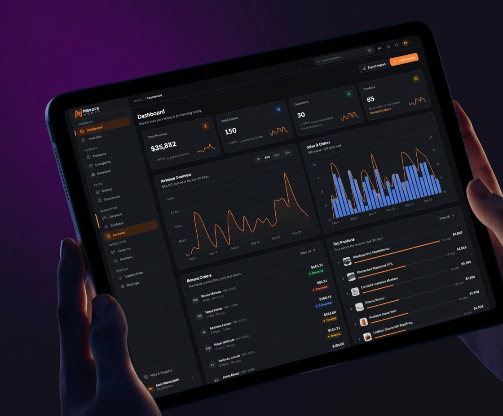
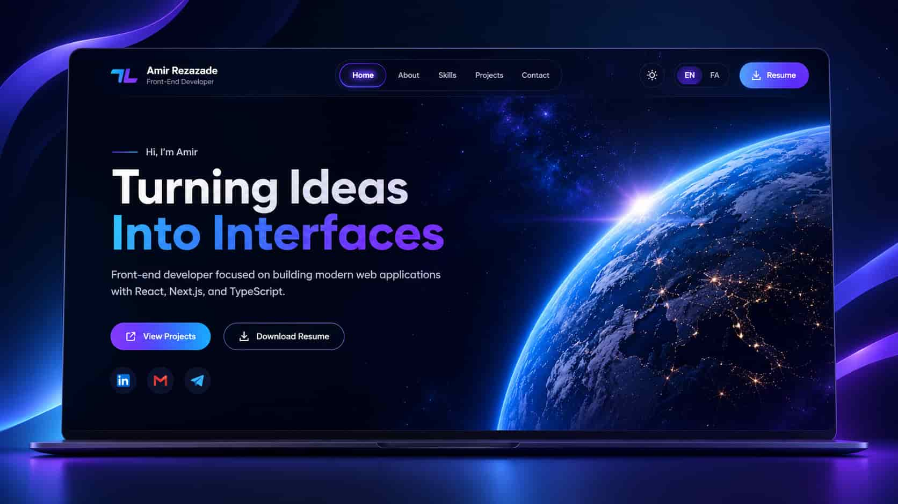
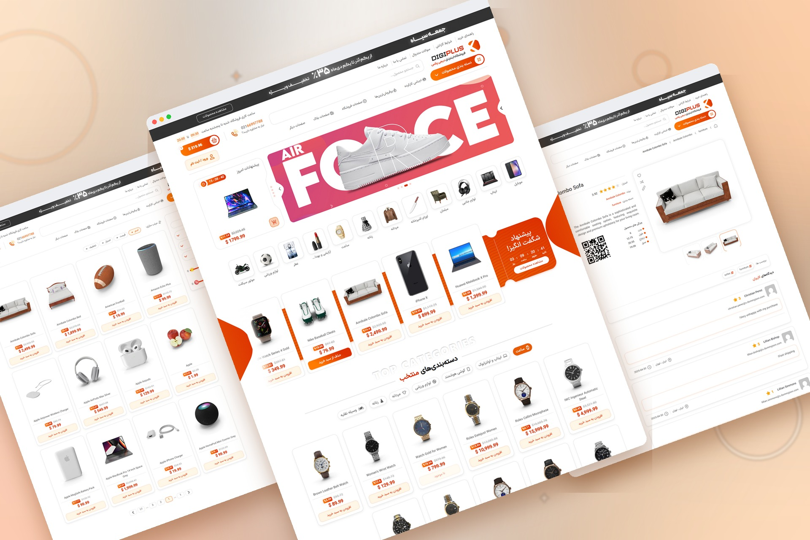
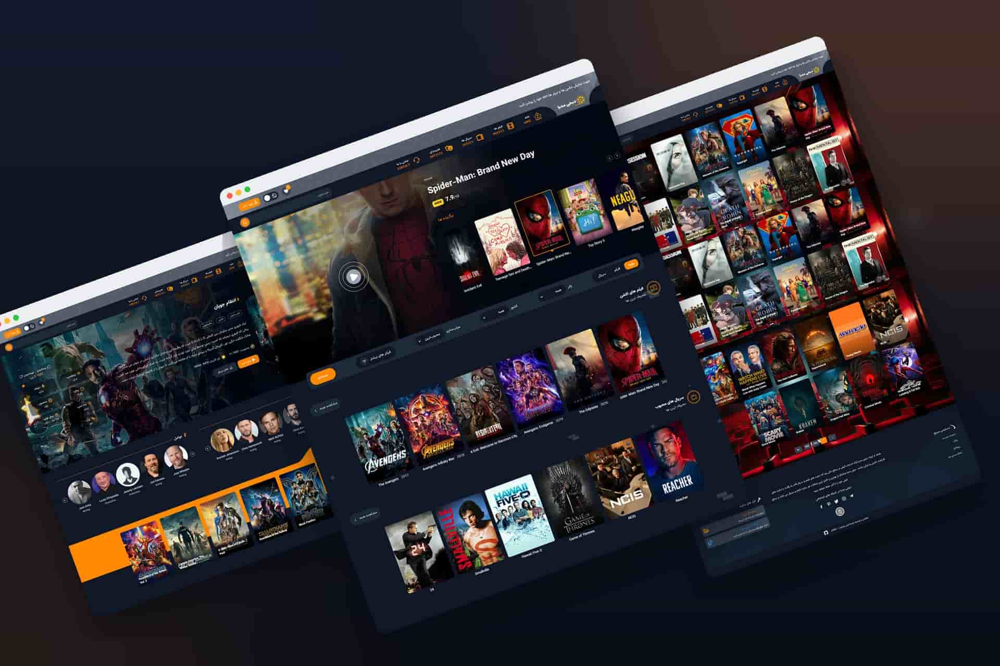

  

# Hi, I'm Amir Rezazadeh

### Front-End Developer | React · Next.js · TypeScript

I'm a Front-End Developer focused on building web applications with React, Next.js, and TypeScript. With a background in Computer Engineering, I enjoy developing practical projects, crafting responsive interfaces, and writing clean, maintainable code.

---

## Tech Stack

  

---

## Featured Projects

### 01. Nexora Admin

  

A modern e-commerce admin dashboard featuring product, order, customer, and analytics management, with bilingual RTL/LTR support and automated end-to-end tests.

**Next.js · React · Redux Toolkit · Tailwind CSS · Playwright**

[Live Demo](https://nexora-admin-app.vercel.app/) · [Source Code](https://github.com/amirRezazade/Nexora-admin)

 

---

### 02. Personal Portfolio

  

A bilingual personal portfolio featuring a custom loading animation, space-inspired visuals, responsive layouts, and accessible interactions.

**Next.js · React · Tailwind CSS · JavaScript**

[Live Demo](https://amir-rezazade.vercel.app/) · [Source Code](https://github.com/amirRezazade/portfolio)

 

---

### 03. Digi Plus

  

A React-based e-commerce project featuring a modern shopping interface and reusable frontend components.

**React · JavaScript · CSS**

[Live Demo](https://digi-plus-store.vercel.app/) · [Source Code](https://github.com/amirRezazade/Digi-Plus)

 

---

### 04. Digi Media

  

A Next.js-based frontend project showcasing my experience building modern web interfaces.

**Next.js · React · JavaScript**

[Live Demo](https://digi-media-next.vercel.app/) · [Source Code](https://github.com/amirRezazade/digi-media-NextJs)

 

---

  <i>Thanks for visiting my GitHub profile!</i>

